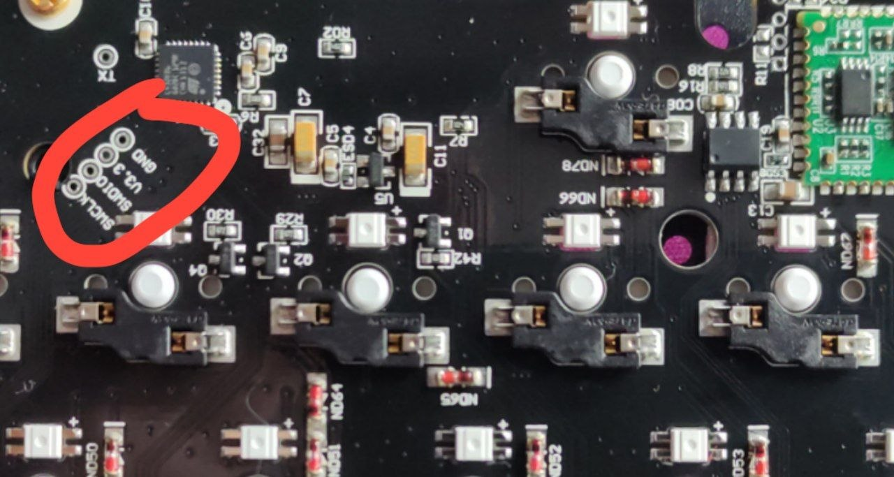

# Keychron K2 Pro


A customizable 84-key wireless mechanical keyboard.

* Keyboard Maintainer: [Keychron](https://github.com/keychron)
* Hardware Supported: Keychron K2 Pro
* Hardware Availability: [Keychron K2 Pro QMK/VIA Wireless Mechanical Keyboard](https://www.keychron.com/products/keychron-k2-pro-qmk-via-wireless-mechanical-keyboard)

## My Keyboard

This repo is set up for a **Keychron K2 Pro ANSI RGB**.

The keymap is named **`custom`** ([source](ansi/rgb/keymaps/custom/keymap.c)). It includes Dvorak/QWERTY switching, Caps-as-Esc/Fn, navigation shortcuts, repeat keys, Caps Word, and VIA support.

## Layout and Fn usage

* Set the **Mac/Win side switch to Mac for Dvorak**, or **Win for QWERTY**. This switch selects the typing layout; both positions keep the same Ctrl/Win/Alt modifier arrangement.
* Keep the computer's English input layout set to **US QWERTY**. The keyboard applies Dvorak itself; enabling Dvorak on the computer as well applies a second conversion.
* Moving the switch **to Dvorak sends F13** to select **US**, and moving it **to QWERTY sends F14** to select **Russian**. The paired Hyprland bindings run `hyprctl switchxkblayout all 0` and `hyprctl switchxkblayout all 1`, respectively, selecting an explicit language on all keyboards rather than toggling.
* This is a switch-change notification, not persistent synchronization: if the desktop misses it while disconnected or logged out, flip away from your desired position and back after reconnecting.
* **Tap Caps Lock for Escape**, or **hold Caps Lock to access Fn shortcuts**. The regular Fn key works too. Release the held key to return to the typing layer.
* **F1–F12 send ordinary function keys** without Fn in both layouts.

**All letter shortcuts below refer to physical QWERTY keycap positions**, including in Dvorak mode. For example, Fn + L means the key normally labeled L, which types N in Dvorak.

## Custom keybindings

### Navigation

Hold Fn (or Caps Lock) while pressing these keys. The bindings are identical in both layouts.

| Shortcut | Action |
|---|---|
| Fn + Q / E | Home / End |
| Fn + W / S | Up / Down |
| Fn + A / D | Left / Right |
| Fn + R / F | Page Up / Page Down |

Add Shift to select text, for example **Fn + Shift + D** to extend selection to the right.

### Repeat and Caps Word

| Shortcut | Action |
|---|---|
| Fn + K | Repeat the last remembered key, including its modifiers |
| Fn + J | Alternate repeat: send the counterpart of a supported key |
| Fn + L | Toggle Caps Word |

**Repeat:** Type a letter, then use Fn + K to type it again. Modifier and Fn keys do not replace the remembered key.

**Alternate repeat:** After Left, Fn + J sends Right; after Home, it sends End; after Backspace, it sends Delete. Only supported key pairs have an alternate; this is not a general undo command.

**Caps Word:** Press Fn + L, release Fn, then type a name such as `CONFIG_VALUE`. Letters are capitalized and the minus key produces an underscore. Digits, underscores, Backspace, and Delete keep Caps Word active. Space or most other punctuation ends it. It also turns off after five seconds of inactivity, or when toggled again with Fn + L.

The **Caps key glows amber while Caps Word is active**, then returns to the normal lighting effect. The indicator follows RGB brightness and requires lighting enabled with brightness above zero. The Caps key itself sends Escape/Fn rather than ordinary Caps Lock.

### Media and system controls

| Shortcut | Action in both layouts |
|---|---|
| Fn + F1 / F2 | Screen brightness down / up |
| Fn + F5 / F6 | Keyboard lighting brightness down / up |
| Fn + F7 | Previous track |
| Fn + F8 | Play / pause |
| Fn + F9 | Next track |
| Fn + F10 | Mute |
| Fn + F11 / F12 | Volume down / up |

Fn + F3/F4 sends **Mission Control/Launchpad in Dvorak mode**, or **Task View/File Explorer in QWERTY mode**. Screen brightness and system shortcuts depend on the computer's OS and desktop bindings.

### Lighting and wireless controls

| Shortcut | Action |
|---|---|
| Top-right lighting key | Next lighting effect |
| Fn + lighting key | Toggle lighting on/off |
| Fn + Page Up | Next lighting effect |
| Fn + Page Down / Home | Hue increase / decrease |
| Fn + Up arrow / End | Lighting brightness increase / decrease |
| Fn + 1 / 2 / 3 | Select Bluetooth device slot 1 / 2 / 3 |
| Hold Fn + 1 / 2 / 3 for more than two seconds | Pair a device with that Bluetooth slot |
| Fn + B | Show battery level on the number-row LEDs |
| Fn + N | Toggle N-key rollover for many simultaneous keypresses |

Bluetooth slot selection and pairing require **Bluetooth mode** on the connection switch. Battery display works while wireless and disconnected from USB power.

VIA can remap these bindings. Its layers are **0: Dvorak, 1: Dvorak Fn, 2: QWERTY, 3: QWERTY Fn**. Saved VIA mappings can override the compiled defaults; if shortcuts differ after flashing, check the corresponding VIA layer.

## Prerequisites

Install the QMK toolchain:

```sh
pip install qmk
qmk setup
```

The ARM cross-compiler must be in your PATH. If `make` fails with `arm-none-eabi-gcc: command not found`, run:

```sh
export PATH="$HOME/.local/share/qmk/bin:$PATH"
```

Add that line to your `~/.bashrc` or `~/.zshrc` to make it permanent.

## Build

```sh
make keychron/k2_pro/ansi/rgb:custom
```

This builds the custom layout documented above with [VIA](https://usevia.app/) support, which lets you remap keys and change RGB effects from a browser app without reflashing. The output is `keychron_k2_pro_ansi_rgb_custom.bin` in the repository root.

> The `via` and `default` keymaps are stock layouts and do not include these custom features. Use `custom` to keep Dvorak switching and the shortcuts above.

## Flash

### Step 1: Set the side switch to Cable (USB) mode

The keyboard must be in wired mode. Flashing does not work over Bluetooth.

### Step 2: Run the flash command

```sh
make keychron/k2_pro/ansi/rgb:custom:flash
```

The firmware will compile (if not already built) and then the terminal will print a message saying it's **waiting for the keyboard to enter bootloader mode**. Don't touch anything yet — leave this running.

### Step 3: Put the keyboard into bootloader

While the terminal is waiting:

1. **Unplug** the USB cable from the keyboard.
2. **Press and hold Esc** on the keyboard.
3. **While still holding Esc**, plug the USB cable back in.
4. Keep holding Esc until the flash process starts in the terminal.

The terminal will detect the keyboard in bootloader mode and flash automatically. When it's done the keyboard will reboot and you're good to go.

> **Tip:** If it doesn't work, try the physical reset button underneath the space bar (use a paperclip) instead of holding Esc.

## Emergency Restore via SWD (Raspberry Pi 5)

If you flash broken firmware and the keyboard stops enumerating over USB (LEDs may still work, but `dmesg -w` shows nothing when plugging in), you can't enter DFU bootloader via Esc or the reset button. In this case, you can flash working firmware directly to the MCU via SWD using a Raspberry Pi 5.

### What you need

* Raspberry Pi 5 (any model with GPIO header)
* 3 jumper wires (female-to-female or female-to-probe clips)
* A working firmware `.bin` file (e.g. `keychron_k2_pro_ansi_rgb_via.bin` from `keyboards/keychron/k2_pro/firmware/`)
* OpenOCD installed on the Pi

### Step 1: Locate SWD pads on the keyboard

The K2 Pro (PCB V1.3, MCU: STM32L432) has SWD pads on the USB-C daughter board labeled:
* **SWCLK**
* **SWDIO**
* **GND**
* **3.3V** (do NOT use this one)



### Step 2: Wire the Raspberry Pi 5 to the K2 Pro

| RPi 5 Physical Pin | GPIO   | K2 Pro SWD Pad |
|---------------------|--------|-----------------|
| Pin 23              | GPIO 11 | SWCLK          |
| Pin 24              | GPIO 8  | SWDIO          |
| Pin 25              | GND     | GND            |

These three pins are right next to each other on the Pi 5 header:

```
  GPIO 11 (23) (24) GPIO 8    ← SWCLK / SWDIO
       GND (25) (26) GPIO 7
```

> ⚠️ **Do NOT connect 3.3V from the Pi to the keyboard.** The keyboard gets power from its own USB cable. Connecting both power sources can damage the board.

> **Important:** Make sure you have solid contact on all three pads. Bad contact is the most common cause of `cannot read IDR` errors. If you get connection errors, reseat/redo your connections before trying anything else.

### Step 3: Power the keyboard

Plug the K2 Pro into USB (a charger or any PC). The Pi only provides the SWD signal lines — the keyboard must be powered separately.

### Step 4: Install OpenOCD on the Pi

```bash
sudo apt update
sudo apt install openocd
```

### Step 5: Copy firmware to the Pi

From your PC:

```bash
scp keychron_k2_pro_ansi_rgb_via.bin admin@<PI_IP>:~/
```

### Step 6: Fix PCIe power saving (Pi 5 specific)

Without this, the first SWD pulses may clock too fast:

```bash
echo performance | sudo tee /sys/module/pcie_aspm/parameters/policy
```

### Step 7: Flash the firmware

```bash
sudo openocd \
  -f interface/raspberrypi5-gpiod.cfg \
  -c "transport select swd" \
  -f target/stm32l4x.cfg \
  -c "program keychron_k2_pro_ansi_rgb_via.bin 0x08000000 verify reset exit"
```

Expected output:

```
** Programming Started **
** Programming Finished **
** Verify Started **
** Verified OK **
** Resetting Target **
```

If you get `target not halted` errors, use the expanded version:

```bash
sudo openocd \
  -f interface/raspberrypi5-gpiod.cfg \
  -c "transport select swd" \
  -f target/stm32l4x.cfg \
  -c "reset_config none" \
  -c "init" \
  -c "reset halt" \
  -c "flash write_image erase keychron_k2_pro_ansi_rgb_via.bin 0x08000000" \
  -c "verify_image keychron_k2_pro_ansi_rgb_via.bin 0x08000000" \
  -c "reset run" \
  -c "exit"
```

### Step 8: Verify

After flashing, unplug and replug the keyboard via USB:

```bash
lsusb | grep -i keychron
```

### Step 9 (Optional): Re-enable DFU bootloader

So you never need SWD again — this sets the option bytes so the reset button enters the built-in DFU bootloader:

```bash
sudo openocd \
  -f interface/raspberrypi5-gpiod.cfg \
  -c "transport select swd" \
  -f target/stm32l4x.cfg \
  -c "init" \
  -c "reset halt" \
  -c "stm32l4x option_write 0 0x20 0xFBFFF8AA" \
  -c "reset run" \
  -c "exit"
```

### Troubleshooting

| Problem | Fix |
|---|---|
| `cannot read IDR` | Most likely **bad contact** on SWD pads. Reseat wires. Also try swapping SWCLK/SWDIO. Make sure keyboard is powered (LEDs on). |
| `target not halted` | Use the expanded flash command above with `reset halt`. |
| `Error: Raspberrypi Pi 5 has moved GPIOs to PCIe connected RP1 chip` | Use `raspberrypi5-gpiod.cfg` instead of `raspberrypi-native.cfg`. |
| `transport select [transport_name]` (prints usage) | Don't put `transport select swd` in the config file — pass it as `-c` on the command line (between `-f interface/...` and `-f target/...`). |
| PCIe speed warning | Run `echo performance \| sudo tee /sys/module/pcie_aspm/parameters/policy` before flashing. |
